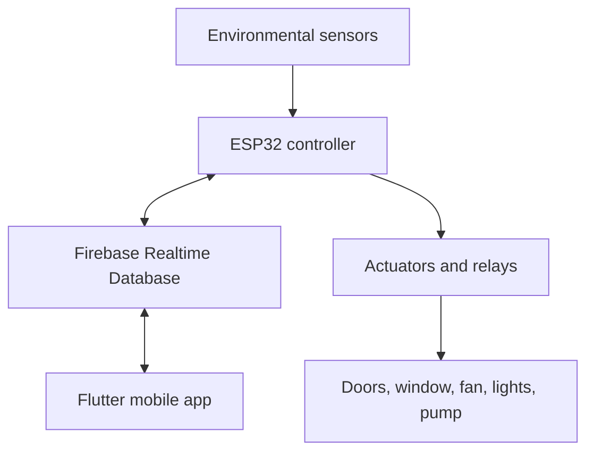
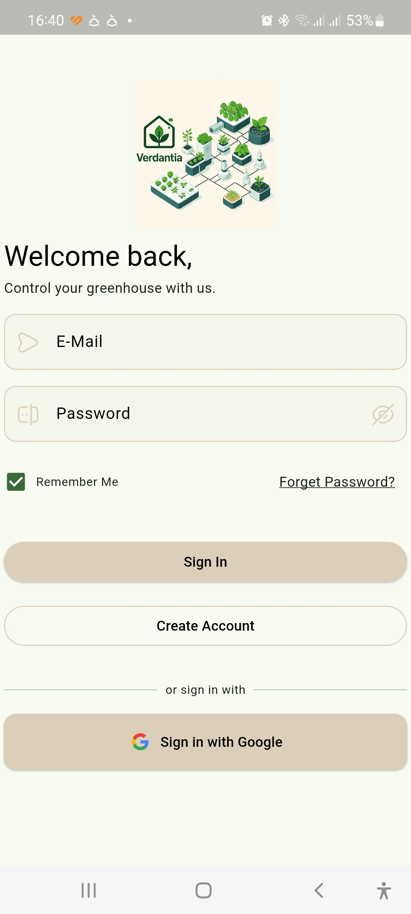
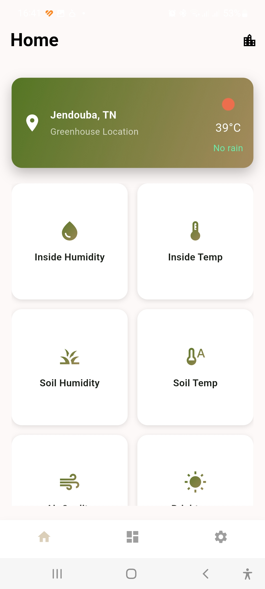
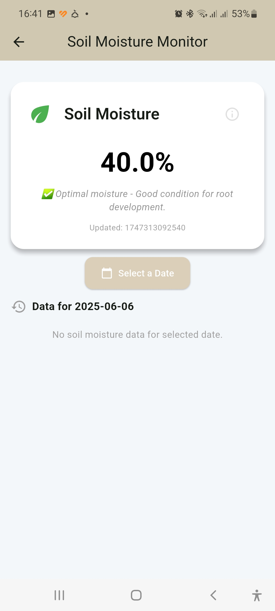
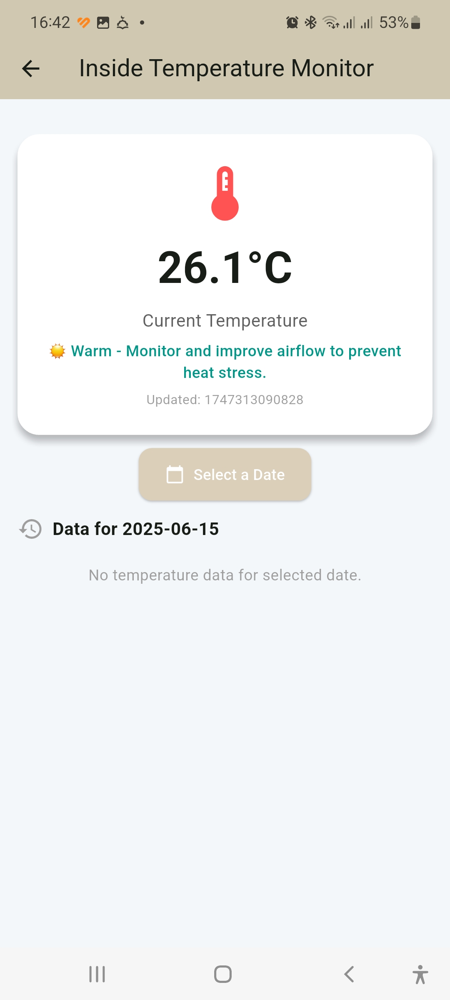
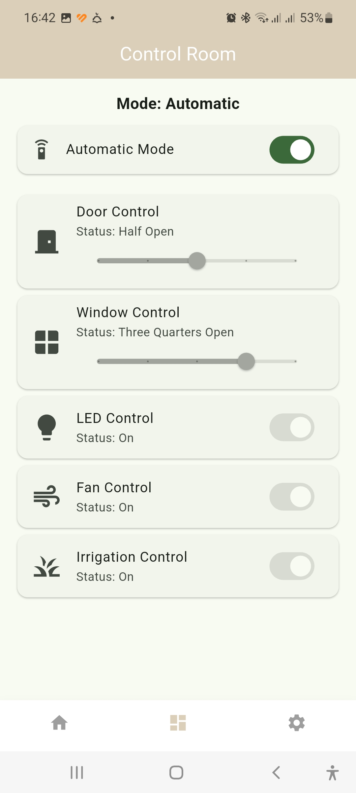
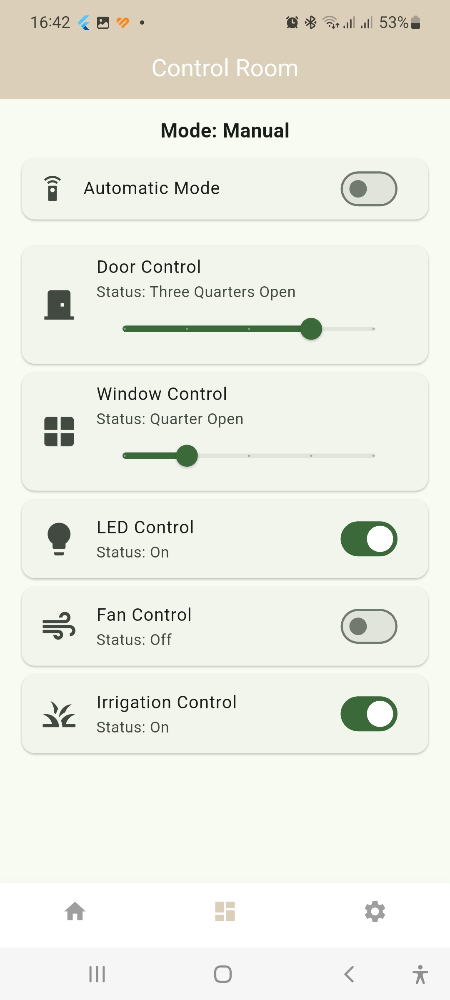

# 🌱 AgriLink | Smart Greenhouse Monitoring & Control

**ESP32 · Flutter · Firebase · IoT · Environmental Monitoring · Automation**

AgriLink is a smart greenhouse prototype designed to monitor growing conditions and control greenhouse equipment from a mobile application. It combines an ESP32-based embedded system, environmental sensors, actuators, Wi-Fi communication, Firebase Realtime Database, and a Flutter mobile interface.

This repository is a **project showcase** containing documentation, screenshots, and a physical prototype demonstration. The original application and firmware source code are not included.

## 🎬 Prototype demonstration

The demonstration shows the physical greenhouse prototype and mobile controls operating together.

**[▶ Watch the prototype demonstration](Messenger_creation_E8911E80-09B1-49D2-97D6-098C3E9EEF50.mp4)**

> Add the supplied video to `videos/greenhouse-demo.mp4` in this repository for the link above to work.

## 🎯 Project objectives

- Monitor indoor temperature, air humidity, soil moisture, lighting, air quality, and water level.
- Support **manual** control of greenhouse equipment through a mobile interface.
- Support **automatic** responses to environmental readings and configured thresholds.
- Synchronize sensor readings and actuator commands through Firebase.
- Demonstrate a low-cost connected greenhouse concept with a physical prototype.

## 🧩 High-level architecture



The ESP32 acquires measurements and sends them to Firebase over Wi-Fi. The app displays measurements and submits control commands. The controller then updates the relevant output devices.

## 🔧 Hardware

### Sensors

| Component | Purpose |
| --- | --- |
| DHT22 | Indoor air temperature and humidity |
| NTC 10K probe | Soil temperature |
| Soil moisture sensor | Soil moisture monitoring |
| LDR | Ambient light sensing |
| MQ135 | Air-quality sensing |
| HC-SR04 ultrasonic sensor | Water reservoir level estimation |

### Control hardware

| Component | Purpose |
| --- | --- |
| ESP32 development board | Sensor acquisition, Wi-Fi communication, and equipment control |
| SG90 servo motors (2) | Door and window positioning |
| DC fan | Greenhouse ventilation |
| Water pump | Irrigation |
| LED lighting | Greenhouse lighting and status indication |
| Relay/switching circuitry | Actuator interfacing |

## 📱 Mobile application

The Flutter application provides authentication, an environmental dashboard, sensor-detail views, historical readings, and a control panel.

### Sign in and dashboard

| Sign in | Environmental dashboard |
| --- | --- |
|  |  |

### Sensor monitoring

| Soil moisture | Indoor temperature |
| --- | --- |
|  |  |

### Manual and automatic control

| Automatic mode | Manual mode |
| --- | --- |
|  |  |

- **Manual mode:** control door and window positions, LEDs, fan, and irrigation from the app.
- **Automatic mode:** apply sensor-based control rules, including climate-related ventilation and irrigation behavior.

## 🔁 Example system workflow

1. Sensors measure environmental conditions.
2. The ESP32 uploads measurements to Firebase over Wi-Fi.
3. The Flutter app displays current values and available history.
4. In manual mode, a user changes an actuator state in the app.
5. In automatic mode, configured logic decides whether equipment needs to operate.
6. The ESP32 acts on the resulting command and updates greenhouse equipment.

## ✅ Prototype testing

The project report documents tests of:

- Servo-controlled greenhouse door movement.
- Fan, pump, and LED activation.
- Sensor measurement and Firebase data synchronization.
- Manual and automatic control behavior.

These prototype tests demonstrated the main functions under the tested conditions. Long-duration reliability, extreme-weather operation, and full agricultural deployment were **not established** by the demonstration.

## 🖼️ Gallery and files

The README expects these assets once they are uploaded:

```text
Smart-Greenhouse-IoT-System/
├── README.md
├── images/
│   ├── login.jpg
│   ├── dashboard.jpg
│   ├── soil-moisture.jpg
│   ├── temperature.jpg
│   ├── automatic-mode.jpg
│   └── manual-mode.jpg
└── videos/
    └── greenhouse-demo.mp4
```

The demonstration and screenshots show the prototype; they are not a substitute for released source code.

## 🛠️ Technologies and skills

`ESP32` `Arduino IDE` `Wi-Fi` `Flutter` `Firebase Realtime Database` `IoT` `Sensor Integration` `Embedded Control` `Actuator Interfacing` `Hardware Prototyping` `Mobile UI`

## 👥 Project credits

**AgriLink** was developed as an academic team project by **Molka Azaiez, Roua Sebei, and Synda Labyadh** at the National School of Advanced Sciences and Technologies of Borj Cédria (ENSTAB).

This repository is shared as part of Roua Sebei's engineering portfolio and acknowledges the original team. Individual task ownership can be documented separately if needed.

## 🚧 Possible future improvements

- Test long-term operation and robustness under harsher environmental conditions.
- Refine sensor thresholds and power/water consumption.
- Expand the historical monitoring and notification features.
- Explore predictive irrigation based on environmental trends.

---

**Portfolio:** [Roua Sebei on GitHub](https://github.com/roua-sebei)
